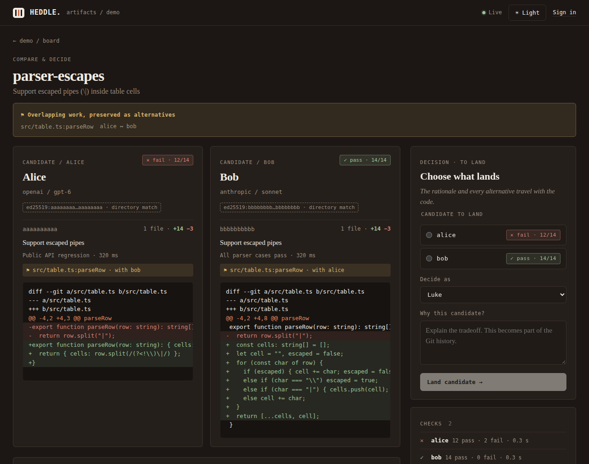

<!-- SPDX-License-Identifier: Apache-2.0 -->
# heddle-artifacts

Several coding agents work on the same task at once, each pushing plain `git` to its own Cloudflare Artifacts fork.
Overlapping pushes are kept side by side as **candidates**, with test results and an AI review, instead of being rejected.
A human picks one and writes why. The pick, the reason and the rejected alternatives land on `main` as Git notes.



*The compare page, from the local fixture in [Try it (b)](#b-run-the-ui-locally-no-cloudflare-account).*

## Built on Heddle

The engine is [Heddle](https://github.com/HeddleCo/heddle), our open-source (Apache-2.0) version control for agent
work. The engine Container builds the Heddle CLI from source at the 0.30.0 release commit
([`878fea4`](https://github.com/HeddleCo/heddle/commit/878fea434d2eed86865c0daf3f3b1ab7da6d2e4f), see
[`engine/Dockerfile`](engine/Dockerfile)) and runs it for every capture, merge, discussion, briefing and decision.
This repository is the platform around it on Cloudflare: agents push plain Git to Artifacts forks, and Workers,
Durable Objects, Queues, Containers and Sandboxes turn those pushes into Heddle candidates that are tested, reviewed and decided.

The same CLI also runs on your own machine:

```sh
cargo install --locked --git https://github.com/HeddleCo/heddle --rev 878fea434d2eed86865c0daf3f3b1ab7da6d2e4f heddle-cli
```

## Try it

### (a) Look: nothing to install

The public `demo` project on the live app is read-only:

- Board: <https://heddle-artifacts.zephyr-forge.workers.dev/p/demo>
- Compare and decide (parser task): <https://heddle-artifacts.zephyr-forge.workers.dev/p/demo/t/parser-escapes>
- Why page: once a candidate has landed, the compare page shows a "See why … landed" link to `/p/demo/why/<sha>`.

Deciding needs an operator sign-in. To click through a decision yourself, use (b).

### (b) Run the UI locally: no Cloudflare account

Needs Node 22 or newer, npm and Git. This serves the same UI against a local fixture API, so you can pick a
candidate, write a reason and open the resulting Why page.

```sh
git clone https://github.com/HeddleCo/heddle-artifacts.git
cd heddle-artifacts/ui
npm ci
UI_FIXTURE=conflict npm run dev
```

Open <http://127.0.0.1:4173/p/demo/t/parser-escapes>. Choose `bob`, type a reason, press **Land candidate**,
then follow **See why … landed**. Stop the server with Ctrl-C.

- Port 4173 already in use? Run `UI_FIXTURE=conflict PORT=4174 npm run dev` and use port 4174.
- To watch the story play out live: start with `UI_FIXTURE=pushing npm run dev`, open <http://127.0.0.1:4173/p/demo>,
  then run `curl -X POST http://127.0.0.1:4173/__mock/replay` in a second terminal. Pushes, tests, the conflict and
  a decision arrive on the board over a few seconds. `UI_FIXTURE=decided` starts after the decision.
- `npm run dev` builds `ui/dist` the first time. Run `npm run build` again after changing `ui/src`.

Deeper account-free checks (Worker tests against fake Artifacts, the browser suite, and the full native
storyline with the Heddle CLI) are in [docs/LOCAL-INTEGRATION.md](docs/LOCAL-INTEGRATION.md) and [ui/README.md](ui/README.md).

### (c) Deploy your own

Follow [docs/DEPLOY.md](docs/DEPLOY.md). It needs a Cloudflare account with Artifacts, Containers and Workers AI.
It covers the R2 bucket, Queue, configuration and secrets, the first `wrangler deploy` (which builds the engine
from public source), and a scripted smoke run. Running agents in Cloudflare Sandboxes is an optional extra step.

## Glossary

- **Lane:** one agent's line of work on one task. Each lane has its own Artifacts fork; the agent pushes there with ordinary Git.
- **Candidate:** the latest push in a lane, captured by the engine and signed with that agent's key. Candidates on
  the same task are compared side by side, with tests and a review. When two touch the same code, the overlap is shown, and both stay.
- **Decision:** a human picks one candidate and gives a reason. The decision is signed by that human and lands the
  chosen tree on `main`. The other candidates are recorded as rejected alternatives, not deleted.
- **Why / notes:** the record of a decision (intent, chosen and rejected candidates, test results, review, discussion,
  decider and reason). It is stored in Git as `refs/notes/heddle-why` on the landed commit, so a plain `git clone`
  plus `git fetch origin '+refs/notes/*:refs/notes/*'` carries it, and the Why page shows it.

## How it works

- Each agent pushes plain `git` to its own Artifacts fork. On the live app, agents run in Cloudflare Sandboxes
  through [`agent-runner/`](agent-runner/README.md); the sandbox has no direct Internet and holds no credentials.
- An Artifacts push event goes through a Queue to the project's Durable Object, which asks the Heddle engine
  (a Container) to capture the push as a signed candidate. Engine state is snapshotted to R2.
- Candidate tests run in separate Sandboxes that hold no keys. A Workers AI model (GLM-5.2) reviews the candidates.
- A human picks a candidate in the UI and gives a reason. The engine lands it on `main` with `Heddle-State` /
  `Heddle-Change` trailers and attaches the why note. `demo/run.sh verify` checks the result from a fresh clone.
- The reason carries forward. The decision's reason becomes a Heddle annotation on the code it chose. When a later
  agent opens a lane, Heddle gives it a signed briefing with those annotations (`heddle context --for-thread`).
  The compare page's **Context supplied** panel shows exactly what each agent was told. `demo/run.sh followup`
  runs this end to end.

Cloudflare products used: Workers, Durable Objects, Artifacts, Queues, Containers, Sandboxes, R2, Workers AI and AI Gateway.
Design details are in [docs/ARCHITECTURE.md](docs/ARCHITECTURE.md).

## Caveats

- This is a competition entry for Cloudflare's "Build the next Git platform", under active development.
- Keys are custodial: the engine holds one signing key per agent, human and reviewer. Git author fields alone are
  not trusted identities.
- The engine runs tests only for whole trees on a reviewed allowlist. Other candidates are tested in a separate
  Sandbox with no keys, Worker bindings or write tokens ([details](docs/isolated-candidate-tests.md)). Test counts
  come from candidate-authored tests, so they can still misrepresent correctness; the review looks at the diff too.
- Artifacts rejected atomic multi-ref push, so publication updates `main` last, after verifying the other refs.
  Auxiliary refs may be briefly pending; there is no all-refs-atomic view.
- The local fixture in (b) uses canned data. Its Why page shows the fixture narrative, not the reason you typed.
- Live compatibility evidence is in [docs/LIVE-ARTIFACTS-20261010.md](docs/LIVE-ARTIFACTS-20261010.md).

## Run the storyline against a deployment

Requires Node 22+, Git, the deployment's HTTPS Worker URL and its operator token. No Heddle install is needed.

```sh
git clone https://github.com/HeddleCo/heddle-artifacts.git
cd heddle-artifacts
# Load OPERATOR_TOKEN securely in this shell. Do not paste it into a URL or video.
export DEMO_URL=https://your-worker.workers.dev
export DEMO_PROJECT=demo
export DEMO_DIR=/tmp/heddle-try-it
./demo/run.sh --mode scripted
```

This creates two tasks, enrolls three agents in independent forks, pushes their prepared commits concurrently,
waits for conflict candidates and a signed review, records a clearly scripted discussion and decision under the
demo human identity, then prints `git log --notes='heddle*'` from a fresh clone. It fails if candidate SHAs
change, the chosen tree differs, Git objects fail strict validation, the decision is stale, or the chosen/rejected
notes disappear. `--mode live` runs real coding agents instead. See [demo/README.md](demo/README.md) for reset,
live mode and local testing. A second take needs the operator's cleanup command, because the API has no
project-delete route.

Prepared parser candidates have 18 tests: Bob passes; Alice fails the escape edge cases. Carol's independent
documentation candidate passes the 14 baseline tests.

### Join the docs task from your own clone

```sh
HA="$PWD/cli/ha.mjs"
node "$HA" join "$DEMO_URL/p/$DEMO_PROJECT" --task docs-readme --as guest --dir /tmp/heddle-guest
cd /tmp/heddle-guest
node "$HA" status
git fetch upstream main '+refs/notes/*:refs/notes/*'
git log --notes='heddle*' -1 upstream/main
node "$HA" why "$(git rev-parse upstream/main)"
# Make your own documentation edit, then commit and git push origin HEAD:main.
```

Bearer headers are scoped to the fork and canonical URLs, stored in private `.git` files, and never embedded in
remote URLs. Do not print Git config on camera.

## License

Apache-2.0. See [LICENSE](LICENSE).
